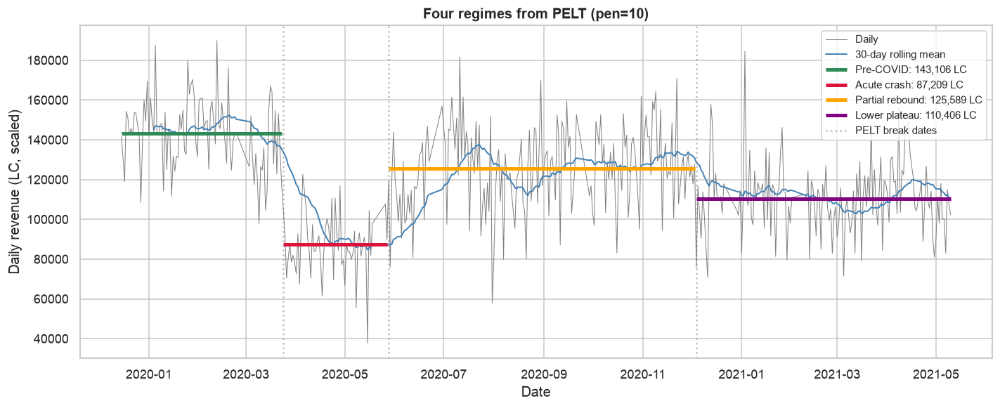

# Pharmacy revenue under COVID-19

Regime detection, volatility testing and forecast validation on 17 months of daily revenue from my own community pharmacy. The analysis is framed around what a model-risk reviewer checks: what the data measure, whether the assumptions hold, whether any information leaks from the future, and whether a claim survives a formal test.



## At a glance

- **Three breaks, four regimes.** Revenue fell about 39% when restrictions began on 24 March 2020, partly recovered from late May, and settled from about December 2020 on a plateau roughly 23% below its pre-COVID level (about 25% below in February–May 2021). A block bootstrap that reruns the break search on every simulated series supports three breaks and not a fourth.
- **No clear change in volatility.** Once level shifts and the weekly pattern are removed, day-to-day variability after COVID is slightly higher in point estimates, and never significantly different.
- **The Friday dip more than doubled.** Friday revenue was about 13% below the other days before COVID, 31% below during the acute crash and 22% below on the plateau. The Friday change is significant under every covariance choice tested; the other days show no robust change.
- **SARIMA beats the simple rule; Prophet is not shown to.** In a rolling-origin evaluation with no look-ahead, SARIMA's week-ahead error is 17.7% lower than the same-weekday rule's (95% interval: 8% to 27% lower), and the difference survives one-sided Diebold–Mariano tests Holm-adjusted across five models (adjusted p = 0.001 a week ahead, 0.009 a day ahead). Prophet's 13.5% lower error is not statistically established (adjusted p = 0.41).

## Scope and data

All findings describe counter cash receipts, about 65% of the pharmacy's revenue: cash purchases, patients' co-payments on insured prescriptions, and products insurance does not cover. The government-reimbursed share of insured prescriptions goes through a separate claims system and is not in the series. Because the series leans towards discretionary purchases, declines during the pandemic probably overstate the fall in the business as a whole.

`data/daily_sales_final.csv` holds the daily series from 15 December 2019 to 10 May 2021: 513 calendar days, 470 observed. For confidentiality, every value is multiplied by one positive constant, chosen so that the sample mean is 120,000 (reported as LC, scaled local currency). Ratios, percentage changes, test statistics and p-values are unaffected.

The 43 missing days are export failures on days the pharmacy traded normally: six complete Tuesday-to-Monday weeks and one single day (13 April 2021). One observed day, 25 December 2019, records an institutional customer settling about a year of credit purchases in a single payment; it is set aside from level comparisons and all models. Small household credit settlements, about 2–3% of total revenue, are recorded on the day they are paid.

## Findings by notebook

Every result is reported whichever way it came out. The questions in NB02–NB04 had been explored on the same data beforehand, so those analyses are exploratory rather than confirmatory.

**NB01: Exploratory analysis.** Establishes what the series measures, why days are missing, and how the one settlement day is handled. Revenue was already about 10% below its January–February level in the three weeks before restrictions began. Friday sits about 23% below the other days; allowing for Fridays with reduced opening hours, at least about 17 of those points are demand.

**NB02: Structural breaks.** Four regimes: pre-COVID (to 23 March 2020), acute crash (24 March to 27 May), partial rebound (28 May to 3 December) and lower plateau (from 4 December). A sup-Wald test rejects "no break". A sequential block bootstrap (999 replicates, 14-day blocks) rejects zero against one, one against two and two against three breaks, but not three against four. Break-date 95% intervals: 23–25 March, 26–30 May, and October 2020 to January 2021. Revenue in February–May 2021 was still about 25% below its pre-COVID level.

**NB03: Volatility.** A two-sided block-bootstrap test of the log variance ratio finds no evidence of change in any of the three primary comparisons (Holm-adjusted p = 0.98–1.00). Point estimates put post-COVID variability slightly above pre-COVID (standard-deviation ratios 1.07–1.16), and the conclusion holds after removing drift within regimes and under a regime-aware weekday correction. On the raw scale, standard deviations fall with the revenue level, which makes the acute crash look calmer than it was. A simulation study (`validation/bootstrap_calibration.py`) shows the test is well calibrated, with a false-positive rate of 4.6–6.4% at the 5% level; its percentile intervals are slightly narrow (87–91% coverage of nominal 95%), which changes no conclusion.

**NB04: Calendar effects.** One regression on log revenue with regime, weekday, month-phase, Ramadan and Eid al-Adha terms, and HAC standard errors. Compared with a single COVID dummy, the four regimes cut the Ljung–Box statistic at lag 7 from about 690 to about 100. The Friday effect averages −22.3% against Tuesday (HAC z = −8.8), but it changed across regimes: about −13% before COVID, −31% in the acute crash, −26% in the partial rebound and −22% on the plateau, relative to the other days. The Friday change is significant under every covariance choice tested. A joint test for changes on the other days is not significant with classical, week-clustered or 7-lag HAC standard errors, but rejects with HAC at 14 lags or more, including the notebook's main choice of 21 lags (p = 0.0002). The statistic rises steadily with the bandwidth, which suggests the covariance estimate is unstable, so a change on the other days is unproven rather than ruled out. A start-of-month lift of 10% or more, the smallest that would matter for staffing and stock, is ruled out (one-sided 95% upper bound +2.4%).

**NB05: Forecasting.** Rolling-origin evaluation over 122 origins from January to May 2021, at horizons of 1, 7 and 30 days, with every model using only data available at each origin: SARIMA and four Prophet variants, all refit at every origin, against seasonal-naive and last-value baselines. Each model is tested against the same-weekday rule at one and seven days ahead with a one-sided Diebold–Mariano test (Harvey–Leybourne–Newbold correction), Holm-adjusted across the five models at each horizon. SARIMA's error is 20.7% lower a day ahead and 17.7% lower a week ahead, and both differences survive adjustment (adjusted p = 0.009 and 0.001); Prophet's 18.2% and 13.5% do not (adjusted p = 0.039 and 0.41). The procedure's size under a null built from the data's own loss differentials is checked in `validation/dm_calibration.py`. In a single 130-day forecast from 31 December 2020, the same-weekday rule is best. Break detection on the training data alone finds only two of NB02's three breaks, so using the full-sample dates as changepoints would have been look-ahead. A Prophet variant with separate weekly patterns before and after restrictions began, motivated by NB04, forecasts Fridays worse, because it overestimates the plateau's Friday dip.

### NB05 findings by severity

**Intended use:** day-ahead and week-ahead forecasts of daily counter takings, for staffing and stock orders.

**Overall:** SARIMA is fit for this use in a stable trading period, subject to finding 2. No Prophet variant is shown to be.

**Severity:** High affects whether a model can be used; Medium limits how it can be used; Low is worth knowing but changes nothing.

| # | Severity | Finding | Evidence | Consequence for use |
|---|---|---|---|---|
| 1 | High | No Prophet variant is shown to beat the same-weekday rule. | Prophet default's error is 18.2% lower a day ahead and 13.5% lower a week ahead, Holm-adjusted p = 0.039 and 0.41. Variants A and B are worse than the rule. | Prophet should not replace the rule. |
| 2 | Medium | SARIMA's advantage is shown in one regime only. | All 122 origins fall in the lower plateau (1 January to 10 May 2021), so no forecast spans a break. On training data alone the 4 December break could not be found: only 21 observed days of the plateau precede the cut-off, fewer than PELT's minimum segment of 30 observed days. | Use SARIMA with its errors monitored against the rule, and go back to the rule if SARIMA stops beating it. |
| 3 | Medium | Small gains cannot be detected. | Minimum detectable gain is 14–30% for the three leading models; Prophet's 13.5% a week ahead is neither confirmed nor ruled out. | "Not established" means "can't tell", not "no gain". Re-test as data accumulate. |
| 4 | Low | SARIMA's gain is on working days only. | A week ahead, SARIMA beats the rule by 20–30% from Sunday to Thursday, is level on Friday (1% worse) and is 5% worse on Saturday (descriptive, 13–16 forecasts per weekday). Prophet is 16% worse on Friday (variant C, 25%). | No change: level on Friday; Saturday's 5% rests on 16 forecasts. |
| 5 | Low | SARIMA's day-ahead margin is narrow under the strictest correction. | One-sided p = 0.0018 against a Bonferroni threshold of 0.0033 across all 15 model–horizon comparisons; a week ahead, p = 0.0002. | The week-ahead result is the firmer one. |
| 6 | Low | The test rejects too often a week ahead. | Under a null built from the data, its false-alarm rate is 5.9% at a nominal 2.5% (1.9% a day ahead). | No effect on SARIMA's verdict (adjusted p = 0.001). Read p-values near the threshold with care. |
| 7 | Low | The models don't help with a single long-range forecast. | One 130-day forecast from 31 December 2020: the rule 0.127, SARIMA 0.144, Prophet 0.151 (log MAE). | Outside the intended use. Keep the rule for long-range planning. |
| 8 | Low | Rare large settlements cannot be forecast. | One institutional customer settled about a year of credit purchases in a single payment (25 December 2019). | Expect occasional large under-forecasts. Treat known settlements separately. |

## How the model-risk checks map to the notebooks

- **Autocorrelation:** HAC standard errors in NB02 and NB04, with bandwidth sensitivity checked from 7 to 28 days; Ljung–Box diagnostics; block bootstraps wherever a statistic would otherwise assume independent days.
- **Selection from the data:** the number of breaks is tested with a bootstrap that reruns the break search on every simulated series (NB02).
- **Multiple testing:** Holm adjustment within each family of tests (NB03, NB04, NB05).
- **Look-ahead:** rolling-origin evaluation with baselines computed at each origin, and changepoints estimated on training data only (NB05).
- **Validating the tools:** the shared bootstrap, forecast-test and SPA code (`pharmacy_covid_analysis/`) has 20 unit tests; one simulation script checks the variance test's false-positive rate and interval coverage (NB03), and another checks the size of the forecast comparison under a null built from the data (NB05).
- **Negative results:** reported in the same way as positive ones. Prophet's advantage over the simple rule is not statistically established (NB05), and there is no evidence of a change in volatility (NB03).

## Limitations

- Only counter cash receipts, about 65% of revenue.
- Daily totals only, with no product detail. The explanation for the Friday change (Friday sales are mostly non-prescription, because doctors' surgeries are closed on the local weekend) cannot be tested directly. About 20% of Fridays ran on reduced opening hours throughout the sample, so the change with COVID is not explained by hours.
- Ramadan (a month-long religious observance, not itself a public holiday) and Eid al-Adha (public holiday) are the only religious-calendar effects modelled. Eid al-Fitr could not be estimated: in 2020 it fell in a missing week, and in 2021 after the sample ends. Public holidays such as New Year and Labour Day are not modelled either.
- With about 110 forecasts per horizon, gains in forecast error smaller than about 14–30% for the three leading models could not be reliably detected. Under a null built from the data's own loss differentials (`validation/dm_calibration.py`), the Holm procedure rejects 1.9% of the time a day ahead and 5.9% a week ahead at a nominal 2.5%; SARIMA's week-ahead adjusted p (0.001) is far below 2.5%. Two bootstrap tests for superior predictive ability on the same forecasts (`arch`'s, which does not studentise, and Hansen's studentised version) are reported in NB05, with their sizes under the same null and the reason the Holm procedure is the test used.
- Six missing weeks (five in the training window, one in the test window) and one missing day. SARIMA handles them through the Kalman filter; the other analyses skip missing days.
- One pharmacy and one sample period.

## Install and run

```bash
git clone https://github.com/ahkheniche/pharmacy-covid-analysis.git
cd pharmacy-covid-analysis
python -m venv .venv && source .venv/bin/activate
pip install -r requirements.txt
pip install -e .                   # makes the pharmacy_covid_analysis package importable
pytest tests/                      # 20 tests, a few seconds
jupyter lab notebooks/             # run in order, NB01 to NB05
```

Tested with Python 3.14. The pinned package versions in `requirements.txt` may not resolve on older Pythons; `pyproject.toml` sets `requires-python = ">=3.14"` so installation fails on older Pythons instead of mismatching package versions.

Approximate runtimes on a modern laptop:

| Notebook | Runtime | Notes |
|---|---|---|
| `01_eda.ipynb` | about 1 min | |
| `02_change_points.ipynb` | 15–25 min | Sequential block bootstrap: 999 replicates for each test and block length, run in parallel |
| `03_volatility.ipynb` | about 2 min | Block bootstraps for the primary and robustness comparisons |
| `04_calendar_effects.ipynb` | about 1 min | |
| `05_forecast.ipynb` | 1–2 min | 488 Prophet fits (122 origins × 4 variants) and 122 SARIMA refits |
| `validation/bootstrap_calibration.py` | about 2 min | Run separately from the notebooks |
| `validation/dm_calibration.py` | 10–15 min | Run after NB05, which writes the forecast table it reads |

The first Prophet fit in a new environment can be slower than later ones.

## Repository layout

```
pharmacy-covid-analysis/
├── data/
│   └── daily_sales_final.csv       # scaled daily series (see Scope and data)
├── notebooks/
│   ├── 01_eda.ipynb
│   ├── 02_change_points.ipynb
│   ├── 03_volatility.ipynb
│   ├── 04_calendar_effects.ipynb
│   └── 05_forecast.ipynb
├── pharmacy_covid_analysis/        # installable package
│   ├── __init__.py
│   ├── bootstrap.py                # shared bootstrap code for NB02 and NB03
│   ├── forecast_tests.py           # Diebold–Mariano test with HLN correction (NB05)
│   └── spa.py                      # Hansen's studentised SPA and StepM (NB05, calibration)
├── tests/
│   ├── test_bootstrap.py           # 11 unit tests
│   ├── test_forecast_tests.py      # 5 unit tests
│   └── test_spa.py                 # 4 unit tests, one pinning the un-studentised mode to arch
├── validation/
│   ├── bootstrap_calibration.py    # simulation check of test size and interval coverage
│   ├── dm_calibration.py           # size of the NB05 forecast comparison under a data-based null
│   └── nb05_rolling_forecasts.csv  # forecast table written by NB05, read by dm_calibration.py
├── charts/                         # figures generated by the notebooks
├── reports/                        # PDF exports of the executed notebooks
├── pyproject.toml
├── requirements.txt
└── README.md
```

## About

Abdelhak Kheniche. The data are from the independent community pharmacy I owned and ran for 22 years; the analysis is my own. [LinkedIn](https://www.linkedin.com/in/abdelhak-kheniche/)
